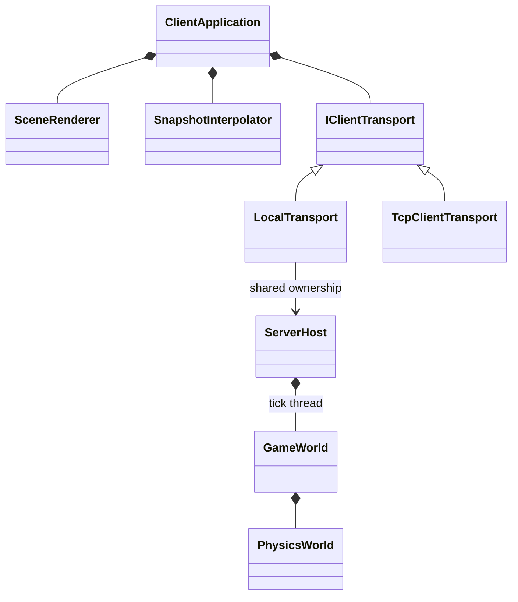

# C++ 가독성·설계 리뷰 — Issue #23

이 문서의 본문은 #23 당시의 리뷰 기록입니다. 서버 실행 클래스와 Protobuf 전환 이후의 구조는 [서버 구조 문서](docs/SERVER_ARCHITECTURE.md), 현재 메시지 형식은 [PROTOCOL.md](PROTOCOL.md)를 참고하세요. 당시 `Wire.h`의 수동 직렬화는 #26에서 `Network/Protocol/Codec.*`와 `.proto` 스키마로 대체합니다.

## 현재 전체 코드 스타일 — Issue #33

[Islewright/Islewright의 629574d 버전](https://github.com/Islewright/Islewright/tree/629574d301d8061e3efecbb2155ee710b2002ec5)을 참고해 Client·Common·Network·Server·Tests의 이름과 서식을 통일했습니다. 참고한 부분은 [World의 메서드·멤버](https://github.com/Islewright/Islewright/blob/629574d301d8061e3efecbb2155ee710b2002ec5/common/include/islewright/common/world.hpp), [좌표 보조 함수](https://github.com/Islewright/Islewright/blob/629574d301d8061e3efecbb2155ee710b2002ec5/common/include/islewright/common/coords.hpp), [서식 설정](https://github.com/Islewright/Islewright/blob/629574d301d8061e3efecbb2155ee710b2002ec5/.clang-format)입니다. 해당 프로젝트의 게임·네트워크 구현을 가져오거나 의존성을 추가하지 않았습니다.

| 구분 | 규칙 | 현재 코드 예 |
| --- | --- | --- |
| 클래스·타입 | PascalCase, 역할을 나타내는 이름 | `ServerNetworkRuntime`, `ClientNetworkRuntime` |
| 멤버 함수·정적 멤버 함수 | PascalCase | `ServerApplication::Run()`, `Quaternion::FromRotation()` |
| 일반 함수 | snake_case | `parse_server_options()`, `wire::read_input()` |
| 비공개 데이터 멤버 | `m_` + lowerCamelCase | `m_networkThread`, `m_latestSnapshot` |
| 고정 상수 | UPPER_SNAKE_CASE | `FIXED_DELTA`, `MAX_QUEUED_INPUTS` |
| 열거 값 | 기존 대문자 규칙 유지 | `MessageType::CLIENT_HELLO` |
| 매개변수·런타임 지역 변수 | lowerCamelCase | `playerId`, `bindAddress` |
| 단순 값 타입 필드 | 기존 좌표·데이터 이름 유지 | `Vector3::x`, `InputCommand::playerId` |

서버 옵션·내부 명령 값 타입의 기존 `m_` 필드는 유지합니다. 런타임에서 얻은 값은 `const`여도 지역 변수 규칙을 따릅니다. 표준 라이브러리·Asio·raylib·생성 Protobuf의 함수 이름은 해당 API 그대로 사용합니다. 클래스 멤버 `Run()`과 외부 함수 `io_context::run()`은 이 때문에 표기가 다릅니다.

클라이언트에 남아 있던 `TcpClientTransport::Impl`은 `TcpClientTransport::ClientNetworkRuntime`, `impl_`은 `m_networkRuntime`으로 변경했습니다. 객체 소유권과 함수 본문 순서는 유지합니다. 서비스·루트 네임스페이스 `MoongTangE`, 기존 `.h/.cpp` 파일 이름과 라이브러리 구분도 유지합니다. 서버와 공유 TCP 채널의 비템플릿 함수 정의는 계속 `.cpp`에 둡니다.

서식은 4칸 들여쓰기·100열 제한이며 클래스·구조체·열거형·함수의 여는 중괄호를 다음 줄에 둡니다. `if`·`for` 같은 제어문은 같은 줄에 둡니다. `.clang-format`은 이 배치와 include 정렬을, `.clang-tidy`는 메서드·일반 함수·비공개 멤버·상수·열거 값의 이름을 검사합니다. 변경은 이름과 서식에 한정하며 분기·연산·상수 값·프로토콜 스키마·CLI 옵션·스레드와 잠금 범위를 유지합니다.

빈 줄도 의미 단위로 배치합니다. [참고 저장소의 입력 초기화](https://github.com/Islewright/Islewright/blob/629574d301d8061e3efecbb2155ee710b2002ec5/client/src/input.cpp)처럼 같은 역할의 선언·계산·상태 갱신은 붙이고, 역할이 바뀔 때 한 줄을 띄웁니다.

- 헤더는 생성·소멸, 연결 관리, 송수신, 상태 조회와 관련된 선언끼리 묶습니다. 멤버도 소유 자원·공유 상태·표시 상태 등으로 구분하며 선언 순서는 유지합니다.
- 함수는 검증·자원 준비·작업 수행·종료 처리의 경계를 구분합니다. 하나의 계산에 필요한 변수와 계산식, 같은 상태를 갱신하는 문장, 중복 호출을 확인하는 연속 테스트는 붙여 둡니다.
- `ServerHost::Run()`은 명령 큐 인수 → 명령 적용 → 물리 진행 → Snapshot 게시 → 다음 Tick 대기 순서로 구분합니다. `ServerApplication::Run()`은 실행 전 검증 → 서버 생성 → 종료 이벤트 등록 → 상태 게시 → 제어 루프로 구분합니다.
- `#pragma once`와 include, 네임스페이스 경계에는 빈 줄을 둡니다. 그 외 중괄호 바로 다음의 불필요한 빈 줄과 연속 빈 줄은 formatter가 정리합니다. 의미에 따른 묶음은 사람이 정하고 formatter는 그 배치를 유지합니다.

## 서버 명명·파일 구성 기록 — Issue #29

- 서비스 이름은 `MoongTangE`입니다. CMake 프로젝트명, 클라이언트 창·화면 제목, README와 저장소 링크를 함께 갱신했습니다.
- Client·Common·Network·Server·Tests 전체의 최상위 네임스페이스도 `MoongTangE`입니다. Protobuf 패키지는 `MoongTangE.proto`, 빌드 옵션·컴파일 매크로·환경변수는 `MOONGTANGE_`, CMake 내부 도우미는 `moongtange_`로 통일했습니다. CI·정적 분석 명령·문서의 사용 예도 함께 변경했습니다. 생성 메시지의 정규화된 타입 이름은 바뀌지만 필드 번호와 전송 바이트는 유지합니다.
- `AsioServer::Impl`은 `ServerNetworkRuntime`으로 바꾸고 별도 `.h/.cpp`로 분리했습니다. `AsioServer`는 전방 선언과 `unique_ptr`로 구현을 숨기며, 네트워크 스레드·세션·Snapshot 타이머는 runtime이 소유합니다.
- 서버 및 공유 `TcpChannel`의 데이터 멤버는 `m_`를 사용합니다. `ServerOptions`와 내부 `WorldCommand`도 값 타입을 유지하면서 멤버 접두사를 적용했습니다. 고정 상수·열거 값은 대문자이며, 런타임의 `const` 지역 변수는 lowerCamelCase입니다.
- `WorldCommandType`과 `wire::MessageType`은 종류가 무엇인지 이름으로 드러냅니다. 공유 시뮬레이션·프로토콜 상수 이름은 모든 클라이언트·테스트 호출부까지 갱신하며 값과 wire 형식은 유지합니다.
- `ServerOptions`, `TickScheduler`, `ServerHost`, `TcpChannel`의 비템플릿 함수 본문은 `.cpp`에 둡니다. 기본값·상수·default/delete 선언은 헤더에 유지합니다. `ServerOptions`는 Common만 사용하는 독립 CMake 라이브러리이며 CLI 테스트는 네트워크를 끈 구성에서도 이를 연결합니다.
- 서버 Tick의 단독 월드 변경, bounded queue, 콜백의 공유 소유권, 네트워크 종료 후 코어 종료 순서를 유지합니다. 검증 결과는 #29의 PR에 기록합니다. 아래의 과거 `Impl`·파일 개수는 당시 리뷰 기록입니다.

명명과 함수 위치는 [서버 아키텍처의 파일별 토글](docs/SERVER_ARCHITECTURE.md#파일별-함수-안내)에서 확인할 수 있습니다.

## 범위와 기준

`Client`, `Common`, `Network`, `Server`, `Tests`의 프로젝트 소유 C++ 전체를 검토했습니다. 정리 후 범위는 `.cpp` 18개와 `.h` 27개입니다. CMake, CI, 테스트 실행 도구도 함께 점검했습니다. 다운로드한 raylib/Asio 소스와 빌드 산출물은 수정 대상에서 제외했습니다.

설계 기준은 Stroustrup/Sutter가 편집하는 [C++ Core Guidelines](https://isocpp.github.io/CppCoreGuidelines/CppCoreGuidelines)입니다. 이는 ISO C++ 언어 표준과 별개의 권고 지침입니다. 4칸 들여쓰기와 100열 제한은 프로젝트의 서식 선택이며, C++ 표준이 강제하는 규칙으로 취급하지 않습니다.

## 발견 사항과 수정

| 발견 사항 | 수정 | 적용 기준 |
| --- | --- | --- |
| 여러 문장과 분기가 한 줄에 몰려 실행 순서가 불분명함 | 전체 C++에 동일한 서식·중괄호를 적용하고 독립 커밋으로 분리 | F.3, NL 계열 |
| 클라이언트 main이 옵션, 연결, 화면, 입력, 종료를 모두 처리 | `ClientOptions`, `ClientApplication`, `GraphicsWindow`, `SceneRenderer`로 역할 분리 | F.2, F.3, C.3 |
| 창·스크린샷 해제를 정상/예외 경로에서 따로 관리 | 창과 이미지가 소멸자에서 자원을 해제하도록 RAII 적용 | R.1, R.20 |
| 물리 적분, 마찰, 구름 저항, 정지 처리가 한 함수에 혼재 | `PhysicsWorld`가 검증된 재질을 보유하고 각 물리 단계는 이름 있는 비공개 함수로 분리 | F.2, C.9 |
| Tick, Snapshot 간격, 반지름, 생성 위치, 조작력 숫자가 중복됨 | `SimulationConfig.h`에 공유 규칙을 모으고 국소 한도는 소유 클래스의 상수로 선언 | ES.45 |
| Wire Reader의 커서와 Writer의 버퍼가 공개되고 잘못된 정수 폭을 허용 | 내부 상태를 비공개로 바꾸고 1–8바이트 및 값 범위를 검증. 잘못된 shift 폭·범위 초과 읽기 회귀 테스트 추가 | C.2, C.9, I.5 |
| `readHello(data, true/false)`와 ID 0에 따라 역할이 바뀌는 API | `clientHello`, `serverHello`, `readClientHello`, `readServerHello`로 의도를 명시 | I.4, F.1 |
| TCP 외부 함수가 Impl의 mutex·ID·큐를 직접 조작 | Pimpl을 비공개 상태를 가진 클래스로 만들고 연결/송신/수신/종료 메서드로 접근 | C.3, C.9, CP.50 |
| 채널 콜백을 임의로 바꾸거나 start를 반복할 수 있음 | `start`가 핸들러를 한 번 설치하고 공유 소유권/중복 시작을 검증 | C.2, C.41 |
| 수신 Snapshot을 소비하면 과거 Tick을 거르는 기준도 사라짐 | 마지막 수신 Tick을 별도 보관. 이미 소비한 뒤 도착한 과거 상태를 거부하는 실제 TCP 회귀 테스트 추가 | 클래스 불변조건, 상태 수명 |
| 연결 객체의 복사/이동 정책이 암묵적임 | 인터페이스와 자원 소유자의 복사·이동 제한을 명시. 가상 소멸자/override 유지 | C.21, C.35, C.67 |
| 명령행 처리와 실행이 붙어 있어 경계 조건을 단위 검증하기 어려움 | 순수 옵션 파서와 `OptionReader` 분리. 누락 값, 빈 주소, 대괄호 오류, 모드 충돌, 범위 초과 테스트 추가 | F.2, I.5 |
| 긴 테스트에서 실패 목적을 찾기 어려움 | 물리·프로토콜·네트워크·통합 테스트를 시나리오 함수로 분리. 실패에 파일명/줄 번호 표시 | F.2, F.3 |
| 서식과 헤더 의존성에 지속적인 검사 없음 | 고정 버전 서식 검사, 선택한 clang-tidy 규칙, 헤더별 독립 컴파일 추가 | ES.20, SF.10, SF.11 |

## OOP 평가

기존 `IClientTransport`의 순수 가상 인터페이스와 Local/TCP 구현, 서버의 월드 소유권, 네트워크 Pimpl은 적절했습니다. 반면 클라이언트 실행 흐름과 네트워크 구현의 내부 상태 접근은 책임 분리가 부족했습니다. 이번 변경은 그 경계를 명확히 했습니다.

`ClientApplication`은 전송 인터페이스, 렌더러, 보간기를 합성합니다. 전송 구현만 교체하면 같은 실행 흐름을 사용합니다. `SceneRenderer`는 구의 메시를 소유하고, `GraphicsWindow`는 그래픽 자원 수명을 책임집니다. `ServerHost`는 명령 큐와 스레드를 관리하며 Tick 스레드만 `GameWorld`를 변경합니다. 각 TCP Impl은 콜백 단계와 동기화 상태를 내부에 숨깁니다.



벡터·quaternion·입력·Snapshot은 값 타입으로 유지합니다. `RigidBody`는 물리 단계가 검증하고 변경하는 시뮬레이션 상태입니다. 모든 필드를 getter/setter로 바꾸거나 새 상속 계층을 만드는 방식은 적용하지 않았습니다. 인터페이스 상속은 교체 가능한 전송에 사용하고, 나머지 책임은 합성으로 표현합니다(C.2, C.120, C.121).

## 전체 점검 기록

| 영역 | 확인한 파일/책임 | 결과 |
| --- | --- | --- |
| 수학 | `Vector3.h`, `Quaternion.h` | 연산 순서 유지, 자세 계산 변수·경계값 이름과 전제조건 설명 개선 |
| 물리 | `RigidBody.h`, `PhysicsWorld.h`, `SpherePlane.h` | 접촉/자세/저항 책임 분리, 상태 검증 유지 |
| 게임 | `GameWorld.h`, `PlayerController.h`, `SimulationConfig.h` | 입력 유효성·만료·인원 제한 유지, 중복 규칙 통합 |
| 프로토콜 | `InputCommand.h`, `WorldSnapshot.h`, `Wire.h` | DTO 유지, 코덱 캡슐화와 경계 검증, v2 바이트 순서 유지 |
| 클라이언트 실행 | `main.cpp`, `ClientApplication.*`, `ClientOptions.h`, `Keyboard.h` | 옵션·세션·입력·화면 책임 구분, 수명 합성 |
| 화면 | `Scene.*`, `GraphicsWindow.h`, `SnapshotInterpolator.h` | 헤더와 렌더링 구현 분리, 메시 소유권, RAII, 표시 전용 보간 유지 |
| 전송 | `IClientTransport.h`, `LocalTransport.h`, `TcpClientTransport.*` | 다형성·소유권·스레드 경계 명시, 단조 증가 Tick 유지 |
| 네트워크 | `TcpChannel.h`, `AsioServer.*` | 콜백 설치·연결 수명·큐·취소 처리를 검토하고 캡슐화 |
| 서버 실행 | `Server/main.cpp`, `ServerOptions.h`, `ServerHost.*`, `TickScheduler.h` | 시작/종료 순서, 큐/잠금, 고정 Tick, 시그널 경계 확인 |
| 공통 유틸리티 | `CommandLine.h` | 이름 있는 Endpoint와 옵션 커서, 파서 경계 검증 |
| 자동 테스트 | 모든 `*Tests.cpp`, `RemoteProbe.cpp`, `TestSupport.h` | 기존 물리/전송 조건 보존, 시나리오 이름과 진단 개선, 경계 회귀 추가 |
| 빌드/검사 | CMake, `HeaderChecks.cmake`, CI, `Tools/*.py` | 27개 헤더 독립 컴파일, 45개 파일 서식 검사, 18개 번역 단위 정적 분석 |

## 검증과 적용 범위

- clang-format 22.1.3으로 전체 C++ 45개 파일을 검사합니다. CI에서도 같은 버전을 사용합니다.
- clang-tidy 22.1.3과 `.clang-tidy`에 명시한 버그·초기화·특수 멤버·소멸자·override·중괄호 규칙으로 18개 번역 단위를 분석합니다. 정적 분석은 모든 Core Guidelines를 자동 인증하는 도구가 아니며 수동 설계 리뷰를 함께 수행했습니다.
- 기존 `21-ROLL`과 같은 MSVC Release 환경에서 32명·2,400 Tick의 동일 입력을 실행했습니다. 생성된 물리 Snapshot/프로토콜 바이트의 SHA-256이 모두 `920c0f09e38988f2bec7042df6b844bd54b3ecd254320c55ea4c3a4fd08f68cc`로 일치했습니다. 이는 플랫폼 간 결정성 보장은 아닙니다.
- 전체 CTest 11개, 외부 의존성 없는 구성 8개와 헤더 컴파일 검사를 유지합니다. 실행 환경별 최종 결과는 이 작업 PR의 검증 항목과 CI에서 확인합니다.
- Linux/macOS GUI 실행과 ThreadSanitizer는 이번 로컬 검증에 포함하지 않습니다. CI는 3개 플랫폼 빌드/테스트를 수행하고, 실제 GUI 실행은 Windows에서 검사합니다.

## 병합 전 재검토 (2026-10-17)

사용자의 명시적인 병합 요청에 따라 기존 PR의 변경 범위와 최신 검증 결과를 다시 확인했습니다. 서버 Tick의 단일 월드 소유권, 잠금과 종료 순서, 네트워크 프레이밍·입력 검증·큐 제한, 구름 물리, 표시 전용 보간 및 회귀 테스트를 재검토했고, 추가로 병합을 막을 C++ 결함은 발견하지 못했습니다. 이는 결함이 전혀 없다는 보장은 아닙니다.

병합 후에도 초기 README만 main에 있다고 안내하는 문서와 무조건적인 병합 금지 문구는 새 요청과 맞지 않으므로 수정했습니다. README의 가져오기 안내는 기본 브랜치를 사용하고, 작업 규칙과 PR 템플릿은 명시적인 사용자 승인·성공한 검사·순차 병합·이슈 자동 종료를 요구합니다. 최초 지시서는 운영 지시 갱신 주석을 추가하고 원문을 보존했습니다. 이번 추가 수정에는 C++ 동작 변경이 없습니다.

각 병합은 검토한 커밋을 지정하여 실행하고, 선행 PR과 main의 파일 내용이 동일한지 확인한 뒤 다음 PR을 main으로 재지정합니다. 실제 병합 시각과 이슈 종료 이력은 GitHub PR/이슈 기록에서 확인합니다.

Windows Release 전체 빌드와 CTest 11/11, 코어 빌드와 CTest 8/8을 다시 실행하여 통과했습니다. 각 구성의 헤더 독립 컴파일도 빌드에 포함되었습니다.

## 재현 명령

```sh
python -m pip install clang-format==22.1.3
python Tools/check_format.py
# 자동 정리: python Tools/check_format.py --fix

# 전체 빌드로 의존성과 Protobuf 생성 헤더가 준비된 뒤 실행
python Tools/run_tidy.py --clang-tidy /path/to/clang-tidy --build-dir build

cmake --build build --config Release --parallel 4
ctest --test-dir build -C Release --output-on-failure
```

Windows에서 도구가 PATH에 없다면 `--clang-format` 또는 `--clang-tidy`에 실행 파일의 절대 경로를 전달합니다. 헤더 검사는 `BUILD_TESTING=ON`일 때 기본 빌드에 포함됩니다.

참고: [LLVM clang-format](https://clang.llvm.org/docs/ClangFormatStyleOptions.html), [LLVM clang-tidy](https://clang.llvm.org/extra/clang-tidy/), [고정 버전 formatter 배포](https://pypi.org/project/clang-format/22.1.3/).
