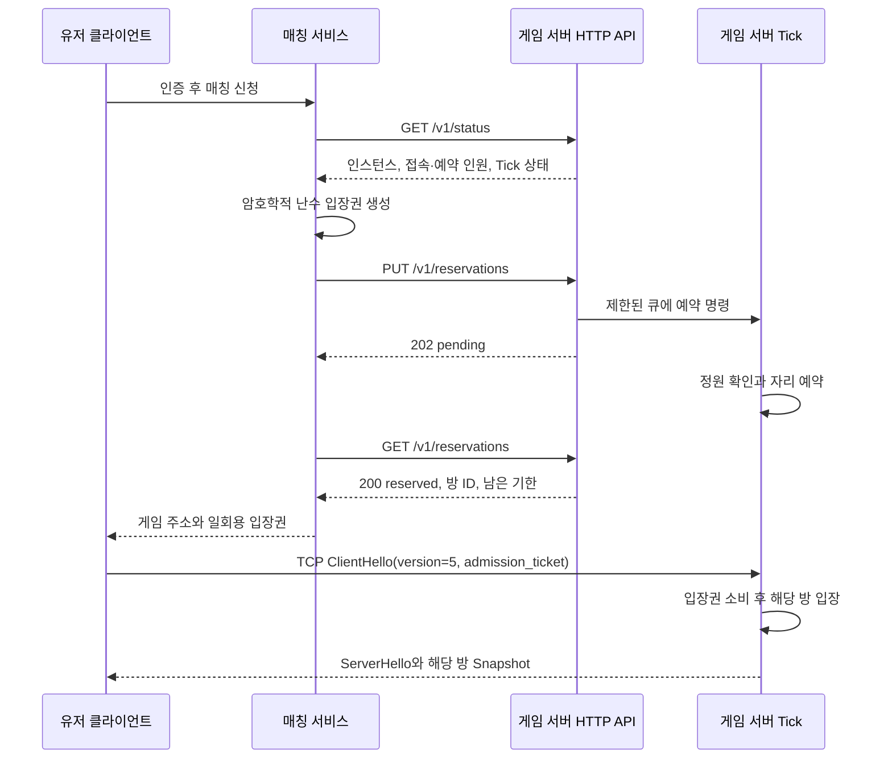

# 매칭 API 연동 — Issue #43

게임 서버에 별도 HTTP 관리 포트를 추가합니다. 방당 정원 3명은 **접속 인원 + 예약 인원**에 적용하며, 생성 순서대로 빈자리를 채웁니다. 예약만 된 플레이어는 물리 월드와 Snapshot에 나타나지 않습니다. 모든 예약·입장·취소·만료에 따른 월드 변경은 서버 Tick 스레드에서 처리합니다.

현재 저장소에는 외부 매칭 서비스나 유저 인증 서비스가 없습니다. 이번 구현은 게임 서버 API와 실제 실행 가능한 Python 연동 어댑터입니다. 매칭 서비스가 상태를 조회하는 방식으로 시작합니다. 주기적인 상태 푸시, 서비스 등록·검색, 파티·실력 기반 매칭, 계정 인증·재접속 복구는 포함하지 않습니다.

## 연결 흐름



상태의 `available`은 후보 선택용입니다. 예약 성공은 반드시 `reserved` 응답으로 확인합니다. 조회 뒤 자리가 바뀌어도 예약 결정은 Tick에서 직렬 처리하므로 초과 배정하지 않습니다. 다른 서버에 재배정할 때에는 기존 예약을 취소하고 **새 입장권**을 생성합니다.

## 실행

PowerShell 예시입니다. 인증키는 매칭 서비스와 게임 서버만 공유합니다.

```powershell
$env:MOONGTANGE_API_KEY = python -c "import secrets; print(secrets.token_hex(32))"
.\build\Release\DedicatedServer.exe --port 27015 --api-port 27016 --require-ticket
```

같은 환경변수를 가진 별도 터미널에서 연동 예제를 실행합니다.

```powershell
python Tools/matchmaking_client.py --api http://127.0.0.1:27016 --client build/Release/Client.exe
```

`--client`를 생략하면 게임 주소·방 ID·입장권을 JSON으로 출력합니다. 이 출력은 요청한 유저에게 전달하는 데모 배정 결과이며, 서버 로그에 저장하지 않습니다. 매칭 백엔드에서는 `MatchmakingClient(api_url, api_key).reserve(game_host)`를 호출합니다. `game_host`는 클라이언트가 접근할 수 있는 배포 주소를 매칭 서비스에서 설정합니다. API의 `game_port`는 실제 바인딩한 포트이며 NAT/프록시를 쓰면 외부 포트도 매칭 서비스에서 변환해야 합니다.

직접 게임 클라이언트를 실행할 수도 있습니다.

```text
Client --connect 127.0.0.1:27015 --ticket <64자리 소문자 hex>
```

예제는 로컬 확인용입니다. 실제 앱에서는 입장권을 메모리로 `TcpClientTransport`에 넘겨 명령행·로그에 남기지 않습니다. API 키를 게임 클라이언트에 전달하지 않습니다.

| 서버 옵션 | 기본값 / 의미 |
| --- | --- |
| `--api-port N` | 생략하면 API 비활성. 0은 임의 포트. 실행 로그에 실제 포트 표시 |
| `--api-public` | API를 0.0.0.0에 바인딩. 기본 127.0.0.1. `--public`과 독립 |
| `--require-ticket` | 입장권 없는 접속 거부. API 포트 필요. 생략하면 기존 직접 접속도 가능 |
| `--reservation-seconds N` | 기본 30, 범위 1–300. 요청을 큐에 넣은 시각부터 계산 |
| `MOONGTANGE_API_KEY` | API 활성화 시 필수, 공백 없는 ASCII 32–128자. 시작 시 읽고 보관 |

API는 HTTP이며 게임 TCP도 현재 암호화하지 않습니다. 외부 매칭 서비스와 연결할 때 관리 포트 앞에 인증된 사설망 또는 TLS 프록시를 두고 접근을 제한합니다. 실제 유저 통신의 입장권 보호에는 게임 연결의 TLS/보안 터널이 별도로 필요합니다. 인증키·입장권 헤더를 프록시 로그에 기록하지 않습니다. HTTP 유휴 읽기 제한은 전체 요청 시간 제한과 다르므로 외부 프록시에 전체 헤더/요청 기한과 호출률 제한을 설정합니다.

## HTTP 계약 v1

모든 요청에 `Authorization: Bearer <MOONGTANGE_API_KEY>`가 필요합니다. 본문과 쿼리 문자열은 비웁니다. 응답은 JSON, `Cache-Control: no-store`이며 CORS를 허용하지 않습니다. 입장권을 URL에 넣지 않습니다.

`GET /v1/status`는 준비되었으면 200, 중지·시작 전·최근 Tick이 1초 이상 오래됐으면 503입니다.

```json
{"instance_id":"<재시작마다 바뀌는 ID>","ready":true,"protocol_version":5,
 "game_port":27015,"require_ticket":true,"reservation_seconds":30,
 "players_per_room":3,"capacity":24,"players":1,"reserved":2,"available":21,
 "tick":"123","tick_age_ms":5,"rooms":[{"room_id":"1","players":1,"reserved":2}]}
```

`capacity`는 최대 방 수 × 3이며 아직 생성하지 않은 방의 자리도 포함합니다. 빈 서버도 전체 Tick은 진행합니다. 방 ID와 Tick은 JavaScript의 정수 정밀도 손실을 피하려고 문자열입니다. `instance_id`가 달라지면 기존 상태와 요청을 폐기하고 새 배정을 시작합니다. 여러 서버를 조회할 때 2초 간격으로 확인하고 요청 실패·`ready=false`인 서버를 후보에서 제외하는 방식으로 시작할 수 있습니다. 실제 주기는 배포 환경에 맞춥니다.

예약 API에는 다음 헤더 두 개를 추가합니다.

```text
X-Server-Instance: <상태 조회에서 받은 instance_id>
X-Admission-Ticket: <매칭 서비스가 secrets.token_hex(32) 등으로 생성한 입장권>
```

이 입장권은 256비트 무작위 bearer 자격 증명이자 멱등 요청 키입니다. 매칭 서비스가 유저와 연결해 안전하게 보관·전달합니다. 게임 서버에는 계정 모델이 없어 계정 자체를 검증하지 않으며, 입장권 소유자가 한 번 입장할 수 있습니다. 유저가 선택한 값이나 순차 번호를 입장권으로 사용하지 않습니다.

| 요청 | 의미 |
| --- | --- |
| `PUT /v1/reservations` | 신규 예약을 큐에 넣거나 동일 입장권의 기존 결과 조회. 재시도는 기한을 연장하지 않음 |
| `GET /v1/reservations` | 해당 입장권의 상태 조회 |
| `DELETE /v1/reservations` | 미소비 예약 취소를 큐에 등록. 이미 입장한 유저는 퇴장시키지 않음 |

```json
{"status":"reserved","room_id":"1","expires_in_ms":29834}
```

`expires_in_ms`는 서버 응답을 만들 때의 남은 기간이며 전송 시간을 포함한 보장은 아닙니다. `pending`/`reserved` 외 상태는 0입니다. 방을 배정받기 전 `room_id`는 `"0"`입니다. 취소·만료 뒤에는 진단용으로 과거 방 ID가 남을 수 있습니다.

| HTTP / status | 처리 |
| --- | --- |
| 202 `pending` | 아직 적용 전. 50ms 정도 후 같은 입장권으로 조회. 클라이언트에 배정 확정 금지 |
| 200 `reserved` | 자리 확보, 남은 기한 내 TCP 접속 |
| 200 `consumed` | 이미 한 번 소비, 재접속 불가. 연결 실패/퇴장 뒤에는 새 매칭 요청 |
| 409 `full` | 예약할 자리 없음. 이 입장권의 결과는 유지, 새 시도는 새 입장권 |
| 410 `expired` / `cancelled` | 자리 반환, 재사용 불가 |
| 404 `unknown` | 이 서버 인스턴스에 예약 기록 없음 |
| 503 `unavailable` | 코어 중지 또는 큐/기록 한도. 같은 입장권으로 제한된 재시도 가능 |
| 400 / 401 / 409 `instance_mismatch` | 요청 형식 / 인증 / 서버 재시작 확인 |

응답 유실 뒤 같은 입장권으로 PUT 또는 GET하면 기존 결과를 확인합니다. 생성 당시 기한이 지난 뒤 60초까지 결과를 보관하며, 이후 기록을 지웁니다. 이 보관 기간이 지난 요청을 다시 생성하는 것은 새 예약으로 취급될 수 있으므로 **한 번 발급한 입장권을 다시 사용하지 않습니다**. 프로세스 재시작 시 기록은 사라지며 인스턴스 헤더가 이전 요청의 재생성을 막습니다. 영속 저장소는 없습니다.

입장권 없는 직접 접속은 일반 모드에서만 허용됩니다. 유효하지 않은/소비된/취소된/만료된 입장권은 직접 접속으로 대체하지 않고 `UNAVAILABLE`로 거부합니다. 프로토콜 v5는 v4 클라이언트와 호환되지 않아 양쪽을 함께 업데이트합니다.

## 한도와 검증

- 예약 결과 기록 최대 4096개, 생명주기 명령 큐 기본 1024개. 기록 한도에는 최근 실패·소비·취소 기록도 포함됩니다.
- 방당 접속 + 예약 3명. 예약과 직접 접속이 같은 Tick 배정 경로에서 경쟁합니다.
- HTTP 작업 스레드 4개, 대기 연결 16개. 초과 연결은 닫습니다. 요청당 본문 1024바이트, 헤더당 1024바이트·최대 32개, URI 256바이트. 읽기·쓰기 유휴 기한 1초, 연결당 요청 1회입니다.
- `ReservationTests`: 예약과 물리 분리, 동일 키·일회용 소비 경쟁, 직접 접속과 정원 경쟁, 취소·만료·재시작.
- `MatchmakingApiSmoke`: 실제 서버 프로세스의 인증, HTTP→TCP 입장, 3/3 배정, 빈자리 재사용, 응답 재시도, 초과 정원, 소비·취소·만료 거부, 본문 제한, 종료.

빌드·테스트 결과와 플랫폼별 실행 여부는 해당 PR에 기록합니다.
