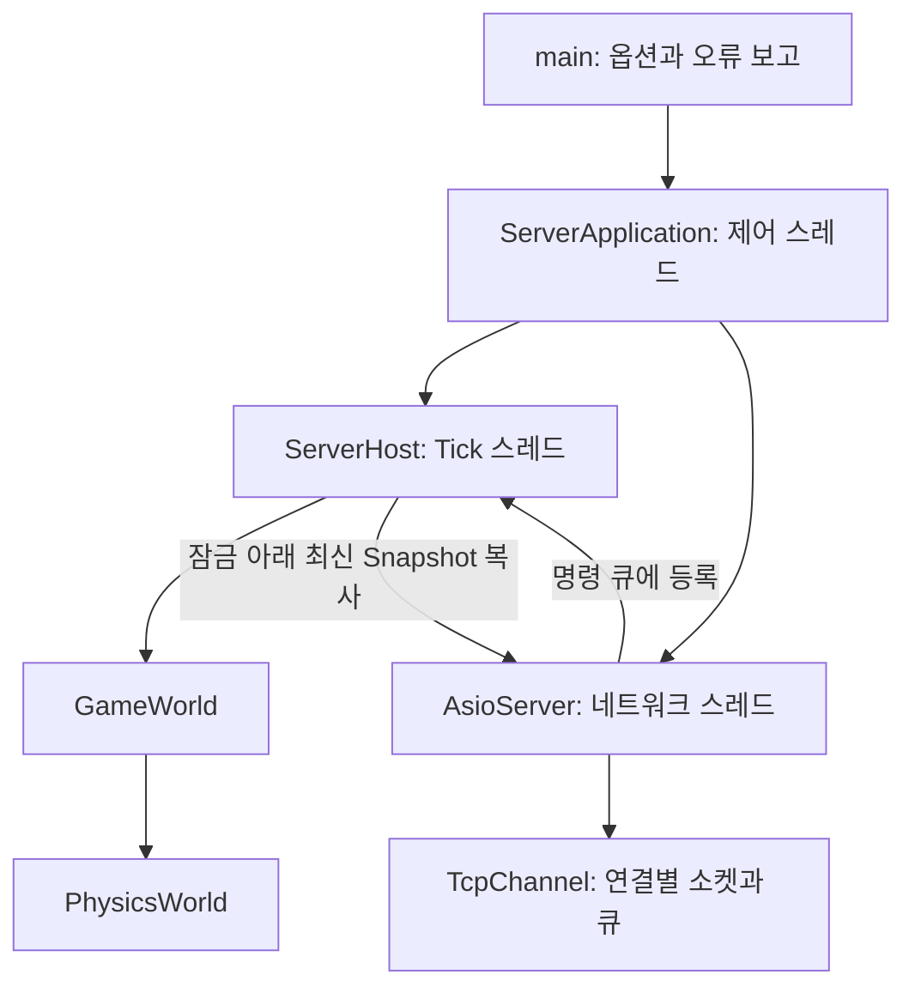
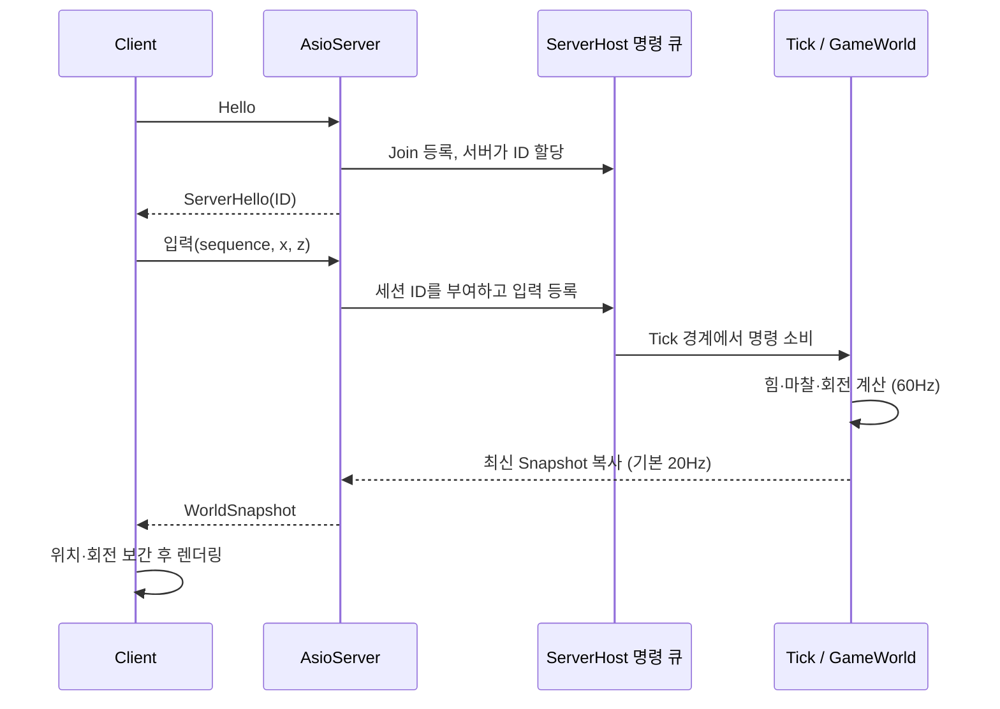
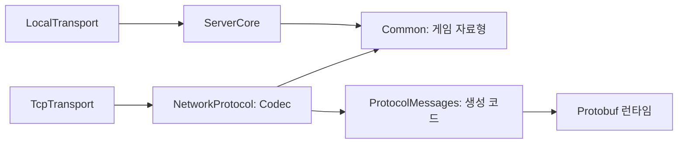

# 서버 구조와 실행 흐름

이 문서는 구현된 서버의 책임, 스레드 경계와 자원 수명을 설명합니다. 실행 진입점은 `Server/main.cpp`, 실행 수명 관리자는 `Server/ServerApplication.*`입니다.

## 구성 요소

| 구성 요소 | 책임 | 하지 않는 일 |
| --- | --- | --- |
| `main` | 명령행 해석, 도움말, `ServerApplication::run()` 호출, 예외와 종료 코드 보고 | 서버 루프와 물리 처리 |
| `ServerApplication` | 독립 서버 시작, 종료 요청·시그널·시간 제한, 실행 중 자원 소유 | 개별 플레이어 물리 변경 |
| `ServerHost` | Tick 스레드, 연결 등록, 제한된 명령 큐, 최신 Snapshot의 안전한 공유 | 소켓·화면 처리 |
| `GameWorld` | 플레이어와 입력 상태, 입력 만료, 물리 단계 호출 | 스레드 생성·소켓 접근 |
| `PhysicsWorld` | 중력, 평면 접촉, 마찰, 구름 저항과 자세 갱신 | 입력 수신·렌더링 |
| `AsioServer` | TCP 연결, Hello, 입력 검증·전달, Snapshot 송신 | 게임 월드 직접 변경 |
| `TcpChannel` | 길이 프레이밍, 부분 송수신, 타임아웃과 전송 큐 | 물리·게임 규칙 |
| `NetworkProtocol` | Protobuf 메시지와 게임 자료형 변환, 메시지 값·크기 검증 | 물리 상태 소유·소켓 I/O |
| `LocalTransport` / `TcpClientTransport` | 동일한 클라이언트 전송 인터페이스 구현 | 클라이언트에서 권위 물리 계산 |

## 소유권과 스레드

독립 서버에는 실행을 제어하는 호출 스레드, 물리 Tick 스레드, 네트워크 스레드가 있습니다. `ServerApplication::run()`은 호출 스레드에서 실행됩니다. 다른 스레드에서는 `requestStop()`과 `port()`만 호출할 수 있습니다. 두 메서드는 atomic 상태를 사용합니다. 애플리케이션 객체를 파괴하기 전에 `run()`이 반환해야 하며, 실행은 객체당 한 번만 허용합니다.

`run()`의 지역 자원은 애플리케이션의 실행 수명을 따릅니다. `ServerHost`를 시작한 뒤 `AsioServer`를 생성합니다. `AsioServer`는 코어의 공유 소유권을 유지합니다. 생성의 역순으로 파괴되어 네트워크 작업을 종료한 뒤 마지막 코어 소유자가 해제됩니다. 바인딩 실패나 출력·이벤트 루프 예외도 같은 RAII 정리 경로를 거칩니다.

`ServerHost::run()` 내부의 `GameWorld`는 Tick 스레드만 접근합니다. `dataMutex_`는 명령 큐·연결 목록·최신 Snapshot을 보호하고, `lifecycleMutex_`는 코어의 시작과 종료를 직렬화합니다. 네트워크 콜백은 `connect`, `submit`, `disconnect`를 호출할 뿐 월드를 직접 변경하지 않습니다.

## 입력에서 화면까지

입력에는 임의의 플레이어 ID를 실어 보낼 수 없습니다. 네트워크 세션의 ID를 서버가 부여하며, 유한한 입력값·범위·증가하는 시퀀스를 검증합니다. 입력이 120 Tick 동안 갱신되지 않으면 조작력을 해제하고 관성 운동은 계속 계산합니다.

물리는 고정 `dt=1/60`을 사용합니다. 기본 Snapshot 게시 간격은 3 Tick입니다. TCP 서버는 약 50ms마다 아직 보내지 않은 최신 상태를 전송하므로 실제 도착 간격은 스케줄링과 네트워크에 영향을 받습니다. 클라이언트의 보간은 표시용이며 서버 상태를 변경하지 않습니다.

## 싱글플레이와 독립 서버

싱글플레이의 `ClientApplication`은 `ServerHost`를 시작하고 `LocalTransport`로 입력과 Snapshot을 교환합니다. 소켓과 `ServerApplication`은 필요하지 않습니다. 독립 서버만 `ServerApplication`을 사용합니다. 두 모드가 같은 `ServerHost`, `GameWorld`, `PhysicsWorld`를 사용하므로 게임 규칙과 물리 구현이 같습니다.

`Common`과 `ServerCore`는 raylib·Asio에 의존하지 않습니다. `ServerRuntime` 빌드 대상은 `ServerApplication` 구현을 제공하고, `TcpTransport`를 통해 서버 네트워크 계층을 사용합니다. `SANDBOX_BUILD_NETWORK=OFF`이면 독립 서버와 `ServerRuntime`을 빌드하지 않습니다.

## Protobuf와 게임 자료형의 경계

`Network/Protocol/game.proto`가 메시지 형식의 원본입니다. CMake가 고정한 protoc 36.2로 `build/generated/game.pb.h`와 `game.pb.cc`를 생성하며 C++ 런타임 7.36.2와 연결합니다. `Network/Protocol/Codec.cpp`만 게임 자료형과 생성된 Protobuf 객체 사이를 변환합니다. 공개 `Codec.h`에는 생성된 타입을 노출하지 않습니다.

게임 월드·물리·LocalTransport는 Protobuf에 의존하지 않습니다. 네트워크를 끈 코어 구성에는 Protobuf와 Abseil 다운로드·빌드가 없습니다. 생성된 메시지를 게임 객체로 사용하거나 상속하지 않고 변환 경계를 둡니다.

TCP 프레임은 **4바이트 big-endian 길이 + 1바이트 메시지 종류 + Protobuf 본문**입니다. 종류별 필수 값, 입력 범위, ID, 중복 플레이어, quaternion 정규화와 유한한 실수를 변환 시 검증합니다. 플레이어 ID는 클라이언트 입력 메시지에 없으며 접속 세션의 ID를 서버에서 주입합니다.

최대 메시지는 8KiB이며, 최대 길이 ID·Tick과 32명 전체 상태를 넣은 Snapshot은 종류 바이트를 포함해 4,300바이트입니다. 이를 수용하기 위해 이전 4KiB 한도를 올렸습니다. 파싱 전에 프레임 크기를 검사하고 Protobuf 재귀 깊이는 16으로 제한합니다. 프로토콜 버전은 3이며 이전 v1/v2 Hello는 거부합니다. 알 수 없는 Protobuf 필드는 크기·재귀 한도 안에서 허용하지만 알려진 값의 검증은 계속 적용됩니다.

## 시작과 종료

1. 옵션을 해석하고 `ServerApplication`을 생성합니다. 생성자는 아직 스레드나 포트를 열지 않습니다.
2. `run()`은 중복 실행을 거부하고, 이미 종료 요청이 있으면 서버를 시작하지 않고 반환합니다.
3. 코어를 시작하고 기본 `127.0.0.1` 주소에 TCP 서버를 바인딩합니다. `--public`으로만 외부 바인딩을 선택할 수 있습니다.
4. 제어용 Asio 이벤트 루프에 SIGINT/SIGTERM과 선택적인 실행 시간 타이머를 등록합니다. 시그널 콜백은 제어 스레드에서 실행됩니다.
5. 실제 포트를 출력하고 `port()`에 게시합니다. 포트 0 옵션은 운영체제가 사용 가능한 포트를 할당하도록 합니다.
6. 종료 요청, 시그널 또는 실행 시간 만료 시 루프를 나갑니다. 외부 종료 요청은 최대 약 50ms의 폴링 간격 이후 반영되며 OS 스케줄링 지연이 추가될 수 있습니다.
7. 제어 이벤트 자원을 해제하고 TCP accept·timer·연결을 닫습니다. 네트워크 콜백을 정리하고 스레드를 join한 뒤 코어 Tick 스레드도 종료합니다.

`requestStop()`은 여러 번 호출해도 안전합니다. `port()`는 시작 전에는 0이고, 정상 시작 뒤에는 종료 후에도 마지막 포트를 유지합니다. 재시작은 새로운 `ServerApplication` 객체로 수행합니다.

## 제한과 검증

최대 32명, Hello 대기 연결을 포함해 최대 64개 TCP 연결을 허용합니다. 코어의 일반 명령 큐는 1,024개이며, 퇴장 처리를 놓치지 않도록 최대 32개의 Leave 명령을 추가로 허용합니다. 각 소켓의 송신 큐는 32개 프레임으로 제한합니다. 자세한 메시지 형식과 시간 제한은 [PROTOCOL.md](../PROTOCOL.md)를 참고하세요.

`ServerApplicationTests`는 실제 연결 후 종료, 중복 종료·실행, 실행 시간 만료, 이미 사용 중인 포트와 사전 취소를 검증합니다. `NetworkTests`는 비정상 프레임·부분 수신·활성 연결 종료를, `IntegrationTests`는 Local/TCP 물리 동작을 확인합니다. `ProcessSmoke`는 별도 프로세스 접속과 시간 제한 종료를 검사하고 POSIX 환경에서는 SIGTERM 정상 종료도 확인합니다. Windows의 외부 SIGTERM 전달은 같은 방식으로 검증하지 않습니다.

공끼리의 충돌, UDP, 예측·롤백, 사용자 인증·암호화는 구현 범위에 포함되지 않습니다. 운영용 공개 서버가 아닌 데모이며, 기본 루프백 또는 신뢰하는 테스트 네트워크에서 사용합니다.
