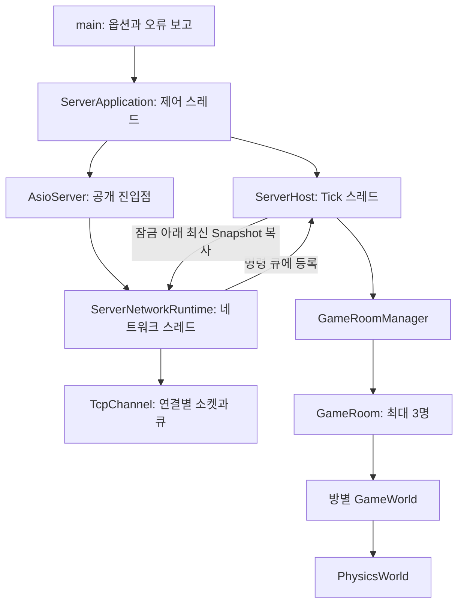
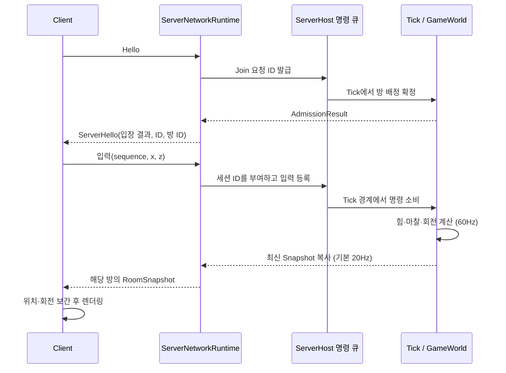
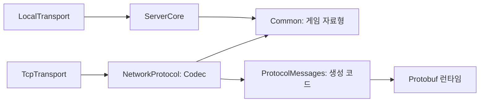

# MoongTangE 서버 구조와 실행 흐름

이 문서는 구현된 서버의 책임, 스레드 경계와 자원 수명을 설명합니다. 실행 진입점은 `Server/main.cpp`, 실행 수명 관리자는 `Server/ServerApplication.*`입니다.

## 구성 요소

### 방 입장 통신 — Issue #36

프로토콜 v8은 `AdmissionResult`(상태·플레이어 ID·방 ID)와 `RoomSnapshot`을 사용합니다.
성공한 Hello의 방 ID와 다른 Snapshot은 클라이언트가 거부합니다. `IClientTransport::RoomId()`는
입장한 방을 제공하며 연결 종료 시 0입니다. 렌더링은 기존 `WorldSnapshot`을 사용하고,
방이 바뀌면 보간 상태를 비웁니다. #37부터 실제 여러 방 배정과 비동기 입장 확정을 사용합니다.

Network/Protocol/Codec.h · Codec.cpp — 방 통신

- `server_hello` / `read_server_hello`: ACCEPTED는 양수 ID 두 개, FULL/UNAVAILABLE/INVALID_NICKNAME은 ID 0 두 개를 요구합니다. PENDING은 전송하지 않습니다.
- `snapshot` / `read_snapshot`: 방 ID·닉네임·물리 Snapshot을 변환하고, 0인 방 ID와 기존 물리 값 오류를 거부합니다.
- 입력에는 방 ID가 없으며 서버가 연결의 소속을 결정합니다. `NetworkProtocol` 빌드 대상과 Common의 의존성 분리는 유지합니다.

Client/Transport/TcpClientTransport.cpp — 입장과 수신

- `ClientNetworkRuntime::RoomId`와 공개 `RoomId`: 잠금으로 보호한 현재 방 ID를 조회합니다.
- `ReceiveMessage`: 입장 결과를 확인한 뒤 동일 방의 증가하는 Tick만 게시합니다.
- `RecordFailure` / `Stop`: 플레이어·방 ID와 수신 버퍼를 지워 종료 뒤 오래된 화면 상태가 남지 않도록 합니다.
- `ClientApplication::ReceiveSnapshot`와 `SnapshotInterpolator::Reset`: 새 방의 작은 Tick도 처음부터 표시합니다.

| 구성 요소 | 책임 | 하지 않는 일 |
| --- | --- | --- |
| `main` | 명령행 해석, 도움말, `ServerApplication::Run()` 호출, 예외와 종료 코드 보고 | 서버 루프와 물리 처리 |
| `ServerApplication` | 독립 서버 시작, 종료 요청·시그널·시간 제한, 실행 중 자원 소유 | 개별 플레이어 물리 변경 |
| `ServerHost` | Tick 스레드, 연결 등록, 제한된 명령 큐, 최신 Snapshot의 안전한 공유 | 소켓·화면 처리 |
| `GameRoomManager` / `GameRoom` | 생성 순서에 따른 3인 방 배정·퇴장·빈 방 정리, 방별 월드 소유 | 소켓과 다른 스레드의 직접 접근 |
| `GameWorld` | 플레이어·수집 물체·입력·결정론적 seed 상태, 입력 만료와 플레이어 충돌 호출 | 스레드 생성·소켓 접근 |
| `PhysicsWorld` | 중력, 지형·변형 콜라이더 접촉, 마찰, 구름 저항과 자세 갱신 | 입력 수신·렌더링 |
| `AsioServer` | 네트워크 실행 객체 소유, 시작·종료와 포트 조회의 공개 진입점 | 개별 세션 처리 |
| `ServerNetworkRuntime` | 네트워크 스레드, TCP 연결, Hello, 입력 검증·전달, Snapshot 송신 | 게임 월드 직접 변경 |
| `TcpChannel` | 길이 프레이밍, 부분 송수신, 타임아웃과 전송 큐 | 물리·게임 규칙 |
| `NetworkProtocol` | Protobuf 메시지와 게임 자료형 변환, 메시지 값·크기 검증 | 물리 상태 소유·소켓 I/O |
| `LocalTransport` / `TcpClientTransport` | 동일한 클라이언트 전송 인터페이스 구현 | 클라이언트에서 권위 물리 계산 |
| `TcpClientTransport::ClientNetworkRuntime` | 클라이언트 연결·Hello·송수신·종료와 네트워크 스레드 소유 | 서버 게임 상태 변경 |

## 소유권과 스레드

독립 서버에는 실행을 제어하는 호출 스레드, 물리 Tick 스레드, 네트워크 스레드가 있습니다. `ServerApplication::Run()`은 호출 스레드에서 실행됩니다. 다른 스레드에서는 `RequestStop()`과 `Port()`만 호출할 수 있습니다. 두 메서드는 atomic 상태를 사용합니다. 애플리케이션 객체를 파괴하기 전에 `Run()`이 반환해야 하며, 실행은 객체당 한 번만 허용합니다.

`Run()`의 지역 자원은 애플리케이션의 실행 수명을 따릅니다. `ServerHost`를 시작한 뒤 `AsioServer`를 생성합니다. `AsioServer::m_networkRuntime`이 `ServerNetworkRuntime`을 단독 소유하고, runtime의 `m_serverHost`가 코어의 공유 소유권을 유지합니다. 생성의 역순으로 파괴되어 네트워크 작업을 종료한 뒤 마지막 코어 소유자가 해제됩니다. 바인딩 실패나 출력·이벤트 루프 예외도 같은 RAII 정리 경로를 거칩니다.

`ServerHost::Run()` 내부의 `GameRoomManager`와 모든 `GameWorld`는 Tick 스레드만 접근합니다. `m_dataMutex`는 `m_pendingCommands`·`m_pendingInputs`·`m_clients`·`m_latestSnapshots`·`m_nextPlayerId`·`m_reservations`·`m_matchmakingState`를 보호하고, `m_lifecycleMutex`는 코어의 시작과 종료를 직렬화합니다. `WorldCommand`는 `WorldCommandType::JOIN/LEAVE/RESERVE/CLAIM/CANCEL`와 요청 ID를 묶는 값 타입입니다. 이동 입력은 별도의 `m_pendingInputs`에 유저마다 최신 값 한 개만 보관합니다. 네트워크 콜백은 `Connect`, `Submit`, `Disconnect`를 호출할 뿐 월드를 직접 변경하지 않습니다.

## 입력에서 화면까지

입력에는 임의의 플레이어 ID나 방 ID를 실어 보낼 수 없습니다. 네트워크 세션의 ID를 서버가 부여하며, 유한한 입력값·범위·증가하는 시퀀스를 검증합니다. 입력이 120 Tick 동안 갱신되지 않으면 조작력을 해제하고 관성 운동은 계속 계산합니다.

물리는 고정 `dt=1/60`을 사용합니다. `Common/Physics/Terrain.h`의 평면·원뿔형 뾰족 지형·구형 언덕 정의를 서버 충돌과 클라이언트 렌더링이 함께 사용합니다. 구와 지형의 접촉 법선 및 침투 깊이는 Common에서 계산하며, 서버 Tick만 위치·속도·회전을 보정합니다. 같은 방의 플레이어는 ID 순서로 쌍을 순회하며 각 변형 콜라이더가 중심 방향으로 갖는 지지 거리를 합쳐 침투를 질량 비율로 분리하고, 접근하는 상대 속도에만 제한된 반발 충격량을 적용합니다. 반복 충돌 풀이 사이마다 같은 변형 콜라이더로 지형 제약을 다시 적용합니다. 기본 Snapshot 게시 간격은 서버의 3 Tick입니다. 방별 Tick은 독립적이며 빈 방은 물리 계산을 건너뜁니다. TCP 서버는 약 50ms마다 아직 보내지 않은 최신 상태를 전송하므로 실제 도착 간격은 스케줄링과 네트워크에 영향을 받습니다. 클라이언트의 보간은 표시용이며 서버 상태를 변경하지 않습니다.

## 결정론적 수집 물체와 변형 콜라이더 — Issues #53, #54, #57

방 생성 시 seed에 따라 간격을 둔 물체 8개를 만들고, 참가자가 있는 동안 5초마다 Y=8에서
새 물체를 떨어뜨립니다. 모든 변경은 기존 Tick 스레드에서 일어나며 최대 24개입니다. 자세한
상수, 난수 변환, 배치 거부, 이중 물리 프록시·로컬 부착, Snapshot과 GLB 정규화 규칙은
[수집 물체 시스템](COLLECTIBLE_SYSTEM.md)에 정리합니다.

Common/Game/GameWorld.h · DeterministicRandom.h — 소환과 물리

- `GameWorld(seed)`는 시작 물체를 만들고 같은 seed의 생성 순서를 재현합니다.
- `SpawnCollectible(falling)`은 종류·고유 크기·방향·XZ 후보를 만들고 최소 간격과 최대 개수를
  검사합니다.
- `PlayerCollider()`는 부착물 반지름의 누적 부피 획득 구체와 고정 54방향 굴림 프록시를
  조립합니다. `Step()`은 굴림 프록시로 플레이어를 먼저 적분합니다.
- `TryAttach()`는 자유 물체 중심이 매끄러운 획득 구체에 들어왔는지 검사하고, 해당 구체
  표면에 로컬 위치·회전을 저장합니다. 부착 순간에는 플레이어 `RigidBody`에 충격량을
  적용하지 않습니다.
- `UpdateAttached()`는 공의 월드 변환으로 붙은 물체의 위치·회전과 분리용 표면 속도를
  갱신합니다. `DetachCollectibles()`는 플레이어 퇴장 시 자유 상태로 되돌립니다.
- `Snapshot()`은 물체 ID·종류·위치·자세·크기와 부착 플레이어 ID를 복사합니다.
- `DeterministicRandom::Next/Index/Range`는 STL 분포에 기대지 않는 고정 난수 변환입니다.

Common/Physics/DeformableBallCollider.h · PhysicsWorld.h — 변형 접촉

- `AddCollectible()`은 부착물 반지름을 누적 부피에 더하고 중심 방향 주변 30도 안쪽의 방사형
  팔들에 smoothstep으로 돌출을 분산합니다.
- `PickupRadius()`, `ContainsPickupCenter()`, `PickupSurface()`는 누적 부피로 성장하는 매끄러운
  획득 구체의 판정과 부착 위치를 제공합니다.
- `Support()`는 누적 부피 반지름을 굴림의 기본 구체로 사용하고 각 돌출을 현재 반지름의
  30%보다 작게 soft-cap한 뒤, 월드 방향으로 가장 먼 기본 지지점 또는 54개 팔 끝을 선택합니다.
- `PhysicsWorld::Step(body, collider, ...)`은 지형 법선 반대 방향의 지지점을 접촉 팔로
  사용합니다. 정상·마찰 충격의 유효질량과 토크, 구름 저항과 정지 판정도 같은 지형 법선과
  접촉 팔을 사용하므로 부착 위치·크기와 지형 경사에 따라 실제 플레이어 운동이 달라집니다.

## 싱글플레이와 독립 서버

싱글플레이의 `ClientApplication`은 메인 화면에서 닉네임을 입력하고 `SINGLE PLAYER`를 선택한 뒤 `ServerHost`를 시작하여 `LocalTransport`로 입력과 Snapshot을 교환합니다. 서버 배정 정보가 있으면 `MULTIPLAYER` 입력이 활성화되고, 선택 시 닉네임을 포함한 Hello로 `TcpClientTransport`가 접속합니다. 서버의 구조화된 입장 오류와 전송 오류는 클라이언트를 종료하지 않고 메뉴 모달에 표시합니다. 게임 중 ESC는 `RESUME GAME`, `OPTIONS`, `EXIT GAME`을 포함한 통합 메뉴를 열고 이동 입력을 중립으로 유지합니다. 옵션은 메인 화면과 동일한 해상도·화면 모드·모니터·VSync·FPS 설정 및 적용 확인 절차를 사용합니다. `RESUME GAME` 또는 옵션 밖에서 ESC를 누르면 게임으로 돌아가며 `EXIT GAME`과 창 닫기는 전송 계층을 먼저 닫은 뒤 그래픽 창을 해제합니다. 자동화용 `--smoke`만 메인 화면을 건너뛰고 실행 옵션에 맞는 전송 계층을 즉시 만듭니다. 소켓과 `ServerApplication`은 로컬 모드에 필요하지 않습니다. 독립 서버만 `ServerApplication`을 사용합니다. 두 모드가 같은 `ServerHost`, `GameWorld`, `PhysicsWorld`를 사용하므로 게임 규칙과 물리 구현이 같습니다.

`Common`과 `ServerCore`는 raylib·Asio에 의존하지 않습니다. `ServerOptions` 라이브러리는 Common만 사용하므로 CLI 파서는 네트워크를 끈 테스트에서도 사용할 수 있습니다. `ServerRuntime` 빌드 대상은 `ServerApplication`과 outbound 전용 `MatchmakingControlClient`를 제공하고, `TcpTransport`·`ServerOptions` 및 비공개 HTTP 의존성 `MatchmakingHttp`를 연결합니다. ASP.NET `MatchmakingApi`는 CMake 대상과 주소 공간을 공유하지 않는 별도 프로젝트입니다. `MOONGTANGE_BUILD_NETWORK=OFF`이면 독립 서버·ServerRuntime·TcpTransport를 빌드하지 않으며, Asio를 직접 포함하는 `ServerNetworkRuntime.h`의 독립 컴파일도 생략합니다.

## 명명과 헤더·구현 분리

모든 프로젝트 C++ 코드는 `MoongTangE` 최상위 네임스페이스를 사용합니다. 공통 상수는 `MoongTangE::simulation`, 전송 코덱은 `MoongTangE::wire`, `package MoongTangE.proto`에서 생성되는 메시지는 `MoongTangE::proto`, 테스트 보조 함수는 `MoongTangE::test`에 속합니다. Client·Common·Network·Server·Tests의 선언과 호출부를 같은 이름으로 맞춥니다. CMake 옵션·컴파일 매크로·화면 캡처 환경변수는 각각 `MOONGTANGE_BUILD_CLIENT`, `MOONGTANGE_BUILD_NETWORK`, `MOONGTANGE_HAS_NETWORK`, `MOONGTANGE_SMOKE_CAPTURE`를 사용하며, 테스트 검증 매크로는 `MOONGTANGE_CHECK`입니다. CMake 내부 도우미와 변수는 `moongtange_` 접두사를 사용합니다.

전체 프로젝트의 멤버 함수는 `Run()`처럼 PascalCase, 일반 함수는 `parse_server_options()`처럼 snake_case를 사용합니다. 비공개 데이터 멤버는 `m_` 접두사(`m_networkThread`), 고정 상수·열거 값은 `UPPER_SNAKE_CASE`(`MAX_PENDING_COMMANDS`)입니다. `ServerOptions`의 기존 필드 `m_port`, `m_runDuration`, `m_publicBind`, `m_showHelp`와 내부 명령의 `m_` 필드는 유지합니다. 매개변수·런타임 지역 변수는 lowerCamelCase이며, `const` 지역 Snapshot 복사도 이 규칙을 따릅니다. 수학·프로토콜의 단순 값 타입은 `x`, `playerId` 같은 데이터 이름을 유지합니다. 참고 저장소와 구체적인 서식 규칙은 [현재 코드 스타일](../CPP_REVIEW.md#현재-전체-코드-스타일--issue-33)에 정리했습니다.

서버와 공유 TCP 채널의 `.h`에는 타입·함수 선언을, 같은 이름의 `.cpp`에는 비템플릿 함수 본문을 둡니다. 상수 정의, 멤버 기본값, default/delete 선언은 헤더에 남깁니다. Common과 클라이언트의 기존 헤더 기반 타입은 유지합니다. 클라이언트 전용 구현체는 `ClientNetworkRuntime`이라는 이름으로 `TcpClientTransport.cpp` 안에 두며 공개 헤더에는 전방 선언과 `m_networkRuntime` 포인터만 둡니다. 이번 이름·서식 정리에서는 파일 경계와 실행 로직을 변경하지 않았습니다.

| CMake 라이브러리 | 구현 파일 | 직접 연결하는 대상 |
| --- | --- | --- |
| `ServerCore` | `ServerHost.cpp`, `TickScheduler.cpp`, `GameRoom.cpp`, `GameRoomManager.cpp`, `GameRoomOptions.cpp` | Common, Threads |
| `ServerOptions` | `ServerOptions.cpp` | Common |
| `TcpTransport` | `AsioServer.cpp`, `ServerNetworkRuntime.cpp`, `TcpChannel.cpp`, `TcpClientTransport.cpp` | ServerCore, AsioStandalone, NetworkProtocol |
| `ServerRuntime` | `ServerApplication.cpp`, `MatchmakingControlClient.cpp` | TcpTransport, ServerOptions, 비공개 MatchmakingHttp |
| `NetworkProtocol` | `Codec.cpp` | Common, ProtocolMessages |

## 파일별 함수 안내

### 3인 방 모델 추가 — Issue #35

`GameRoomManager`는 생성 순서대로 빈자리가 있는 방을 채우고, 후보가 없을 때만 최대 방 수 안에서 새 방을 생성합니다. 방 정원은 3명이며 기본 최대 방 수는 8개, 빈 방 보관 시간은 30초입니다. `ServerHost`가 이 관리자를 Tick 스레드에 생성합니다. 방을 미리 만들지 않으며 기존 참가자를 다른 방으로 옮기지 않습니다. `Common/Protocol/RoomSnapshot.h`는 방 ID와 기존 월드 Snapshot을 묶는 의존성 없는 값 타입입니다.

`GameWorld`는 플레이어 ID와 생성 자리를 분리합니다. 가장 작은 빈 자리로 생성하고 퇴장 시 반환하므로 큰 ID도 새 월드의 첫 자리에서 시작합니다. 물리 계산은 동일합니다. 클라이언트 smoke와 RemoteProbe는 최초 관측 위치를 기준으로 이동을 검증합니다.

추가 구현 파일은 모두 `ServerCore`에 포함되며 헤더 독립 컴파일과 네트워크를 끈 코어 빌드에서 검사합니다.

Server/Core/GameRoomOptions.h · GameRoomOptions.cpp — 방 한도

`Validate()`는 최대 방 수 1–256, 빈 방 보관 시간 0–24시간을 검증합니다. `PLAYERS_PER_ROOM`은 3입니다. 설정은 물리 시간 간격을 변경하지 않습니다.

Server/Core/GameRoom.h · GameRoom.cpp — 독립 게임방

| 함수 | 설명 |
| --- | --- |
| `Join(playerId)` | 정원 내에서 월드에 참가자를 추가하고 빈 방 타이머를 해제합니다. |
| `Leave(playerId, now)` | 참가자를 제거하고 마지막 퇴장 시 단조 시계의 빈 방 시작 시각을 기록합니다. 중복 퇴장은 무시합니다. |
| `Apply(input)` / `Step()` | 해당 월드의 입력·물리를 처리합니다. 빈 월드는 물리 단계를 생략합니다. |
| `PlayerCount()` / `Snapshot()` | 해당 월드의 인원과 상태를 조회합니다. |
| `Expired(now, lifetime)` | 빈 방 보관 기한 경과 여부를 반환합니다. |

Server/Core/GameRoomManager.h · GameRoomManager.cpp — 순차 배정과 방 수명

| 함수 | 설명 |
| --- | --- |
| `Join(playerId, now)` | 만료 방을 제거한 후 생성 순서대로 입장합니다. 기존 빈자리가 없으면 새 방을 생성하고, 전체 한도 또는 잘못된 ID는 0을 반환합니다. |
| `Leave(playerId, now)` | 해당 참가자의 소속 방에서 퇴장시키고 소속 기록을 제거합니다. |
| `Apply(input)` | 서버가 보유한 소속 정보로 대상 월드를 결정합니다. |
| `Step(now)` | 빈 방을 만료시키고 각 월드를 진행합니다. |
| `RoomFor(playerId)` / `RoomCount()` / `PlayerCount()` | 소속과 총 방·참가자 수를 조회합니다. |
| `Snapshot(roomId)` / `Snapshots()` | 특정 방 또는 전체 방의 공개용 상태 복사본을 반환합니다. |
| `ExpireRooms(now)` | 빈 방만 정리하며 살아 있는 방 ID를 재배정하지 않습니다. |

방 ID는 관리자 수명 내에서 증가하며 재사용하지 않습니다. 외부 스레드는 이 관리자에 직접 접근하지 않아야 합니다. 테스트에서는 단조 시각을 주입해 실제 대기 없이 만료 경계를 확인합니다.

파일 이름을 누르면 설명을 펼칠 수 있습니다. 헤더와 구현 파일은 한 쌍으로 표시하며, 기본 생성·소멸과 복사/이동 금지 선언은 역할에 필요한 경우에만 설명합니다.

Server/main.cpp — 프로그램 진입점

[main.cpp](../Server/main.cpp)

| 함수 | 설명 |
| --- | --- |
| `main(argc, argv)` | 명령행 인자를 해석하고 도움말 또는 ServerApplication을 실행합니다. 예외는 오류 메시지와 종료 코드 1로 변환합니다. |

Server/ServerOptions.h · ServerOptions.cpp — 실행 옵션

[선언](../Server/ServerOptions.h) · [구현](../Server/ServerOptions.cpp)

`ServerOptions`는 포트(기본 27015), 실행 시간(기본 0), 방 옵션 `m_rooms`, 외부 바인딩·도움말 여부를 저장하는 값 타입입니다.

| 함수 | 설명 |
| --- | --- |
| `parse_server_options(arguments)` | `--port`, `--public`, `--run-for`, `--max-rooms`(1–256), `--empty-room-seconds`(0–86400), `--world-seed`(uint64), `--help`를 해석합니다. 포트 0은 자동 할당이며 잘못된 옵션·범위를 거부합니다. |

Server/ServerApplication.h · ServerApplication.cpp — 실행 수명과 종료

[선언](../Server/ServerApplication.h) · [구현](../Server/ServerApplication.cpp)

| 함수 | 설명 |
| --- | --- |
| `ServerApplication(options)` | 옵션을 저장하고 음수 실행 시간과 잘못된 방 한도를 거부합니다. 아직 서버를 시작하지 않습니다. |
| `Run()` | 한 번만 실행할 수 있습니다. 코어·네트워크를 시작하고 제어용 Asio 이벤트 루프에서 종료 요청을 기다립니다. 지역 객체의 역순 소멸로 자원을 정리합니다. |
| `RequestStop()` | `m_stopRequested`를 원자적으로 설정합니다. 다른 스레드에서도 호출할 수 있으며 정리 완료를 기다리지는 않습니다. |
| `Port()` | 원자적으로 게시한 실제 포트를 조회합니다. 시작 전에는 0, 종료 후에는 마지막 포트입니다. |
| `start_server_core(options)` (cpp 내부) | 방 설정을 받은 ServerHost를 공유 소유 객체로 만들고 Tick 스레드를 시작합니다. |

`m_hasRun`은 실행 시도 여부이며 현재 가동 여부가 아닙니다. 호출자는 `Run()` 반환 후 애플리케이션을 파괴해야 합니다. `STOP_POLL_INTERVAL`은 종료 플래그 재확인 간격 50ms이며 물리 Tick 간격과 다릅니다.

Server/Core/ServerHost.h · ServerHost.cpp — Tick 스레드와 월드 명령

[선언](../Server/Core/ServerHost.h) · [구현](../Server/Core/ServerHost.cpp)

| 함수 | 설명 |
| --- | --- |
| `Start()` | 가동 상태를 설정하고 Tick 스레드를 시작합니다. 이미 실행 중이면 반환합니다. |
| `Stop()` / `~ServerHost()` | Tick 중단을 요청하고 join한 뒤 명령·연결·Snapshot 상태를 정리합니다. 소멸자도 Stop을 호출합니다. |
| `Running()` | 원자적 가동 상태를 조회합니다. |
| `ServerHost(options)` | 방 설정을 검증합니다. 시작 시 월드는 아직 없습니다. |
| `Connect()` | 요청 ID를 발급하고 JOIN을 등록합니다. 정지·요청/큐 한도·ID 고갈이면 0입니다. 아직 입장 성공을 뜻하지 않습니다. |
| `Admission(playerId)` | PENDING, ACCEPTED(플레이어·방 ID), FULL 또는 UNAVAILABLE을 조회합니다. 입장 취소는 즉시 UNAVAILABLE입니다. |
| `Disconnect(playerId)` | 등록된 연결을 제거하고 LEAVE 명령을 보장하여 큐에 넣습니다. |
| `Submit(input)` | 값·입장 확정·증가하는 시퀀스를 검증하고 해당 유저의 최신 입력 슬롯을 교체합니다. 수락 여부를 반환합니다. |
| `SnapshotFor(playerId)` / `Snapshots()` | 참가자의 방 또는 모든 방의 최신 공개 Snapshot 복사본을 반환합니다. 방별 목록을 전역 월드로 합치지 않습니다. |
| `Capacity()` | 설정된 최대 방 수 × 3을 반환합니다. |
| `Pending()` | 잠금 아래 대기 명령 수를 조회합니다. |
| `HasClient(playerId)` | 실행 중이고 해당 연결의 입장이 확정됐는지 확인합니다. |
| `Run(stopToken)` (비공개) | 명령·입력 큐를 꺼내 JOIN/LEAVE 후 최신 입력을 적용하고 각 방을 고정 시간으로 진행합니다. 3 서버 Tick마다 방별 Snapshot을 게시합니다. 취소된 JOIN은 무시합니다. |

입장·퇴장 명령의 기본 한도는 `MAX_PENDING_COMMANDS = 1024`입니다. 입력은 유저당 하나, 최대 `Capacity()`개로 별도 제한하며 한 유저의 반복 제출이 다른 유저의 슬롯을 차지하지 않습니다. 퇴장 명령은 최대 `Capacity() × 2`개까지 추가되어 정리가 누락되지 않습니다.

Server/Core/TickScheduler.h · TickScheduler.cpp — 고정 Tick 일정

[선언](../Server/Core/TickScheduler.h) · [구현](../Server/Core/TickScheduler.cpp)

| 함수 | 설명 |
| --- | --- |
| `TickScheduler(now)` | 단조 시계 기준 시작 시각을 `m_nextTick`에 저장합니다. 테스트에서는 시각을 주입할 수 있습니다. |
| `Advance(now)` | 다음 Tick 시각에 `TICK_PERIOD`를 더해 반환합니다. `MAX_CATCH_UP_TICKS`(8)보다 크게 지연되면 다음 시각을 재설정합니다. |

스케줄러는 수면이나 물리 계산을 직접 수행하지 않습니다. ServerHost가 반환 시각까지 대기하며 물리 dt는 `simulation::FIXED_DELTA`로 유지합니다.

Server/Network/AsioServer.h · AsioServer.cpp — TCP 서버 공개 진입점

[선언](../Server/Network/AsioServer.h) · [구현](../Server/Network/AsioServer.cpp)

| 함수 | 설명 |
| --- | --- |
| `AsioServer(host, address, port)` | ServerNetworkRuntime을 만들고 `m_networkRuntime`으로 단독 소유합니다. 기본 주소는 루프백입니다. |
| `~AsioServer()` | 소유한 runtime을 파괴해 네트워크 종료를 수행합니다. 불완전 타입의 unique_ptr이므로 cpp에서 정의합니다. |
| `Port()` | runtime이 실제 바인딩한 포트를 반환합니다. |

헤더에는 runtime의 전방 선언만 둬 Asio 구현 세부 사항을 공개 진입점에서 숨깁니다.

Server/Network/ServerNetworkRuntime.h · ServerNetworkRuntime.cpp — 연결·세션·전송 루프

[선언](../Server/Network/ServerNetworkRuntime.h) · [구현](../Server/Network/ServerNetworkRuntime.cpp)

기존 `Impl`의 책임을 명시한 클래스입니다. 아래의 연결/세션 함수와 콜백은 네트워크 스레드에서 실행됩니다. 생성자는 스레드 시작 전에 초기 대기를 등록합니다.

| 함수 | 설명 |
| --- | --- |
| `ServerNetworkRuntime(host, address, port)` | 실행 중인 코어를 확인하고 TCP를 바인딩합니다. 연결 수락·Snapshot 타이머를 등록한 뒤 네트워크 스레드를 시작합니다. |
| `~ServerNetworkRuntime()` | 종료 처리를 io_context에 게시하고 네트워크 스레드를 join합니다. |
| `Port()` | 생성 시 확정된 포트를 조회합니다. |
| `CloseAllSessions()` | 수락·타이머를 중단하고 세션 목록의 복사본을 순회하며 연결을 닫습니다. |
| `AcceptNextConnection()` | 다음 연결을 비동기로 수락합니다. 연결 한도 이내면 세션을 만들고 수락을 다시 등록합니다. |
| `AddSession(socket)` | TcpChannel과 Hello 이전 세션을 만들고 수신/종료 콜백을 설치합니다. weak_ptr로 소유권 순환을 피합니다. |
| `RemoveSession(channel)` | 코어에 퇴장을 요청하고 세션을 제거합니다. |
| `HandleMessage(channel, data)` | 첫 Hello를 검증하고 입장 요청을 등록합니다. 입장 성공 후 입력은 코어 큐에 전달하며 Disconnect·잘못된 메시지는 연결을 종료합니다. |
| `CompleteAdmission(channel)` | Tick에서 확정한 결과를 보냅니다. 실패 응답은 송신 후 연결을 닫고, 대기 중에는 성공 응답을 보내지 않습니다. |
| `BroadcastLatestSnapshot()` | 입장 결과를 확인하고 방마다 한 번 직렬화한 최신 상태를 해당 방의 세션에만 전송합니다. 세션별 마지막 Tick으로 중복 전송을 막습니다. |
| `ScheduleSnapshotBroadcast()` | `SNAPSHOT_INTERVAL`마다 전송 콜백을 실행하고 다음 타이머를 등록합니다. |

TCP 연결 한도는 Hello 대기를 포함해 `Capacity() × 2`개(기본 48개)입니다. `m_sessions`와 전송 상태는 네트워크 스레드가 관리하며 GameWorld는 직접 변경하지 않습니다.

Network/TcpChannel.h · TcpChannel.cpp — 서버·클라이언트 공용 TCP 프레임

[선언](../Network/TcpChannel.h) · [구현](../Network/TcpChannel.cpp)

| 함수 | 설명 |
| --- | --- |
| `TcpChannel(socket)` | 소켓 소유권을 받고 같은 실행 환경의 읽기 제한 타이머를 만듭니다. |
| `Start(onMessage, onClose)` | 콜백·공유 소유권·단일 시작 조건을 검증하고 TCP_NODELAY 설정 후 수신을 시작합니다. |
| `Send(payload)` | 길이 헤더를 붙여 송신 큐에 넣습니다. 큐가 비어 있었다면 쓰기를 시작하며 한도를 넘으면 연결을 닫습니다. |
| `SendAndClose(payload, reason)` | 마지막 응답의 송신 완료 후 닫습니다. 추가 수신 처리를 멈추며 기존 10초 읽기 기한이 정리 상한을 유지합니다. |
| `Close(reason)` | 중복 호출을 무시하고 타이머·소켓·송신 큐를 정리한 뒤 종료 콜백을 호출합니다. |
| `ReadFrameHeader()` | 읽기 제한 시간을 설정하고 4바이트 길이를 읽어 본문 크기를 검증합니다. |
| `ReadFrameBody()` | 지정 길이만큼 읽은 뒤 메시지 콜백을 호출하고 다음 프레임 헤더 수신을 시작합니다. |
| `WriteNextFrame()` | 큐의 첫 프레임을 전송하고 완료 후 다음 프레임을 처리합니다. 콜백이 연결과 버퍼의 공유 소유권을 유지합니다. |

`MAX_QUEUED_FRAMES = 32`, `READ_TIMEOUT = 10초`입니다. 모든 호출은 해당 io_context 스레드에서 직렬로 수행해야 합니다.

Network/Protocol/Codec.h · Codec.cpp — 게임 메시지와 Protobuf 변환

[선언](../Network/Protocol/Codec.h) · [구현](../Network/Protocol/Codec.cpp) · [스키마](../Network/Protocol/game.proto)

| 함수 | 설명 |
| --- | --- |
| `require(condition)` / `type(data)` | 유효성 위반을 예외로 알리고 첫 바이트에서 MessageType을 검사·추출합니다. |
| `client_hello()` / `server_hello(admission)` | 프로토콜 버전·입장 결과·서버 할당 ID·방 ID가 담긴 Hello를 인코딩합니다. |
| `read_client_hello(data)` / `read_server_hello(data)` | Hello 버전과 입장 결과·ID 조합을 검증합니다. 서버 Hello 해석은 AdmissionResult를 반환합니다. |
| `input(command)` / `read_input(data, sessionId)` | 입력을 인코딩하거나 세션 ID를 결합하여 검증된 InputCommand로 해석합니다. |
| `snapshot(room)` / `read_snapshot(data)` | Tick, 플레이어와 최대 24개 수집 물체 상태를 변환하고 개수·ID·종류·필드·수치·회전·크기 및 부착 플레이어 참조를 검사합니다. |
| `disconnect()` / `is_disconnect(data)` | Disconnect를 만들거나 종류와 Protobuf 본문을 검증합니다. |
| `frame(payload)` / `frame_size(header)` | 4바이트 big-endian 길이를 붙이거나 읽고 프레임 한도를 검사합니다. |
| `encode<Message>()` / `decode<Message>()` (cpp 내부) | 메시지 종류와 Protobuf 직렬화/역직렬화, 크기·파서 한도를 공통 처리합니다. |
| `write_vector()` / `read_vector()` / `write_quaternion()` / `read_quaternion()` (cpp 내부) | 벡터·회전을 Protobuf 필드와 게임 값 타입 사이에서 검증하며 변환합니다. |

`PROTOCOL_VERSION = 8`, `MAX_FRAME_BYTES = 8192`, `FRAME_HEADER_BYTES = 4`입니다. MessageType의 대문자 이름 변경은 wire 바이트 값을 바꾸지 않습니다. `.proto`는 데이터 선언이며 함수 구현은 빌드 폴더에서 생성됩니다.

Client/Transport/TcpClientTransport.h · TcpClientTransport.cpp — 클라이언트 TCP 연결

[선언](../Client/Transport/TcpClientTransport.h) · [구현](../Client/Transport/TcpClientTransport.cpp)

공개 `TcpClientTransport`는 `IClientTransport`를 구현하며, 비공개 `ClientNetworkRuntime`을 `m_networkRuntime`으로 소유합니다. 아래 공개 함수는 runtime에 위임하며 소멸 시 콜백을 정리하고 네트워크 스레드를 join합니다.

| 함수 | 설명 |
| --- | --- |
| `TcpClientTransport(host, port)` / `ClientNetworkRuntime(host, port)` | runtime을 생성하고 비동기 연결과 네트워크 스레드를 시작합니다. |
| `Connected()` / `PlayerId()` / `RoomId()` / `Error()` | 잠금 아래 연결 상태·할당 ID·첫 오류를 조회합니다. |
| `Send(input)` | 입력·연결·대기 큐 한도를 검사하고 네트워크 스레드에 전송을 게시합니다. |
| `Receive()` | 잠금 아래 최신 Snapshot을 꺼냅니다. |
| `Close()` / `Stop()` | 종료 상태를 설정합니다. 입장이 완료된 연결은 `Disconnect`를 송신 큐 끝에서 보낸 뒤 소켓을 닫고 네트워크 스레드를 join하며, 연결 중이거나 실패한 연결은 즉시 정리합니다. 반복 호출은 무시합니다. |
| `BeginConnection()` / `ConnectSocket()` | 제한 시간을 설정하고 주소 해석과 TCP 연결을 시작합니다. |
| `StartHandshake()` / `ReceiveMessage()` | TcpChannel 콜백을 등록하고 Hello와 증가하는 Tick의 Snapshot을 처리합니다. |
| `RecordFailure()` / `Fail()` | 첫 오류를 보관하고 ID·주소 해석·타이머·소켓·채널을 정리합니다. |

`MAX_QUEUED_INPUTS = 64`, `HANDSHAKE_TIMEOUT = 5초`입니다. 소비자와 네트워크 스레드가 공유하는 상태는 `m_stateMutex`로 보호하며, 연결 수명과 수신 Tick 순서는 네트워크 스레드가 관리합니다.

## Protobuf와 게임 자료형의 경계

`Network/Protocol/game.proto`가 메시지 형식의 원본입니다. CMake가 고정한 protoc 36.2로 `build/generated/game.pb.h`와 `game.pb.cc`를 생성하며 C++ 런타임 7.36.2와 연결합니다. `Network/Protocol/Codec.cpp`만 게임 자료형과 생성된 Protobuf 객체 사이를 변환합니다. 공개 `Codec.h`에는 생성된 타입을 노출하지 않습니다.

게임 월드·물리·LocalTransport는 Protobuf에 의존하지 않습니다. 네트워크를 끈 코어 구성에는 Protobuf와 Abseil 다운로드·빌드가 없습니다. 생성된 메시지를 게임 객체로 사용하거나 상속하지 않고 변환 경계를 둡니다.

TCP 프레임은 **4바이트 big-endian 길이 + 1바이트 메시지 종류 + Protobuf 본문**입니다. 종류별 필수 값, 입력 범위, ID, 중복 플레이어, quaternion 정규화와 유한한 실수를 변환 시 검증합니다. 플레이어 ID는 클라이언트 입력 메시지에 없으며 접속 세션의 ID를 서버에서 주입합니다.

최대 메시지는 8KiB이며, 코덱의 방어적 상한은 32명입니다. 최대 길이 플레이어·방 ID·Tick과 16자 닉네임을 넣은 32명 Snapshot은 종류 바이트를 포함해 4,878바이트이며, 여기에 최대 24개 부착 물체를 포함해도 상한 안입니다. 실제 게임방은 최대 3명만 허용합니다. 파싱 전에 프레임 크기를 검사하고 Protobuf 재귀 깊이는 16으로 제한합니다. 프로토콜 버전은 8이며 이전 버전 Hello는 거부합니다. 알 수 없는 Protobuf 필드는 크기·재귀 한도 안에서 허용하지만 알려진 값의 검증은 계속 적용됩니다.

## 시작과 종료

1. 옵션을 해석하고 `ServerApplication`을 생성합니다. 생성자는 아직 스레드나 포트를 열지 않습니다.
2. `Run()`은 중복 실행을 거부하고, 이미 종료 요청이 있으면 서버를 시작하지 않고 반환합니다.
3. 코어를 시작하고 기본 `127.0.0.1` 주소에 TCP 서버를 바인딩합니다. `--public`으로만 외부 바인딩을 선택할 수 있습니다.
4. 매칭 URL을 설정했으면 실제 TCP 포트와 공개 주소로 outbound `MatchmakingControlClient`를 시작합니다.
5. 제어용 Asio 이벤트 루프에 SIGINT/SIGTERM과 선택적인 실행 시간 타이머를 등록합니다. 시그널 콜백은 제어 스레드에서 실행됩니다.
6. 실제 포트를 출력하고 `Port()`에 게시합니다. 포트 0 옵션은 운영체제가 사용 가능한 포트를 할당하도록 합니다.
7. 종료 요청, 시그널 또는 실행 시간 만료 시 루프를 나갑니다. 외부 종료 요청은 최대 약 50ms의 폴링 간격 이후 반영되며 OS 스케줄링 지연이 추가될 수 있습니다.
8. 제어 HTTP 스레드를 먼저 join하고 TCP accept·timer·연결을 닫습니다. 네트워크 콜백을 정리한 뒤 코어 Tick 스레드도 종료합니다.

`RequestStop()`은 여러 번 호출해도 안전합니다. `Port()`는 시작 전에는 0이고, 정상 시작 뒤에는 종료 후에도 마지막 포트를 유지합니다. 재시작은 새로운 `ServerApplication` 객체로 수행합니다.

## 제한과 검증

기본 8개 방 × 3명 = 24명이며 최대 방 수를 1–256으로 설정할 수 있습니다. 전체 정원은 `Capacity()`로 표시하며 요청 추적과 TCP 연결은 각각 그 두 배로 제한합니다. 코어의 입장·퇴장 명령 큐는 1,024개이며, 퇴장 처리를 놓치지 않도록 정원의 두 배까지 Leave 명령을 추가로 허용합니다. 최신 입력은 입장한 유저당 하나씩 별도로 유지합니다. 따라서 대기 중 자료의 상한은 1,024 + 정원 × 3개이며 Tick이 인수한 한 배치도 동일하게 제한됩니다. 각 소켓의 송신 큐는 32개 프레임으로 제한합니다. 자세한 메시지 형식과 시간 제한은 [PROTOCOL.md](../PROTOCOL.md)를 참고하세요.

`ServerApplicationTests`는 실제 연결 후 종료, 중복 종료·실행, 실행 시간 만료, 이미 사용 중인 포트와 사전 취소를 검증합니다. `MultiRoomTests`는 Local/TCP 7명의 3/3/1 배정, 방별 상태·입력 격리, 빈자리 우선 배정과 정원 초과 응답을 검증합니다. `NetworkTests`는 비정상 프레임·부분 수신·활성 연결 종료를, `IntegrationTests`는 Local/TCP 물리 동작을 확인합니다. `RoomConcurrencyTests`는 동시 요청 40건, 취소·재시작, 입력 폭주 중 다른 방의 진행, 256개 방/768명 설정 한도를 검증합니다. 이는 성능이나 운영 수용량 보장은 아닙니다. `ProcessSmoke`는 별도 서버에 9명이 접속해 3개 방으로 나뉘는지, 10번째 거절·빈자리 재사용·시간 제한 종료를 검사하고 POSIX 환경에서는 SIGTERM 정상 종료도 확인합니다. Windows의 외부 SIGTERM 전달은 같은 방식으로 검증하지 않습니다.

공끼리의 충돌, UDP, 예측·롤백, 사용자 인증·암호화는 구현 범위에 포함되지 않습니다. 운영용 공개 서버가 아닌 데모이며, 기본 루프백 또는 신뢰하는 테스트 네트워크에서 사용합니다.

## 분리형 매칭 API와 예약 — Issues #43, #51

API 계약·예제 실행은 [MATCHMAKING_API.md](MATCHMAKING_API.md)에 정리합니다. ASP.NET Core `MatchmakingApi`와 C++ `DedicatedServer`는 서로 독립적인 프로세스이며 다른 호스트에서 실행할 수 있습니다. C++ 프로세스는 HTTP를 수신하지 않고 별도 제어 스레드에서 API로 heartbeat를 보냅니다. 제어 스레드는 상태를 복사하거나 제한된 코어 명령 큐를 사용할 뿐 `GameWorld`에 접근하지 않습니다. 예약 정원 판단·소비·취소·만료는 Tick에서만 실행합니다.

MatchmakingApi/Program.cs · MatchmakingStore.cs — 독립 ASP.NET API

- `Program`: 공개 키와 제어 키를 분리해 인증하고 공개 상태·예약 경로와 내부 등록·결과 경로를 구성합니다.
- `MatchmakingStore`: 최근 heartbeat 서버를 후보로 고르고 멱등 예약과 C++로 전달할 reserve/cancel 명령을 보관합니다.
- 공개 예약은 처음에 pending이며 C++ Tick의 결과 보고를 받은 뒤에만 reserved가 됩니다. heartbeat가 3초 이상 끊긴 서버는 후보와 상태 목록에서 제외합니다.
- 저장소는 현재 프로세스 메모리 구현입니다. API 재시작 시 서버가 다음 heartbeat로 재등록하지만 기존 예약 기록은 복구하지 않습니다.

Server/Api/MatchmakingControlClient.h · MatchmakingControlClient.cpp — outbound 제어 연결

- 별도 `jthread`가 1초 간격으로 게임 주소·프로토콜·점유 상태를 ASP.NET API에 전송합니다. API는 마지막 heartbeat 이후 3초가 지나면 해당 서버를 배정 후보에서 제외합니다.
- heartbeat 응답의 제한된 TSV 명령을 검증하고 `ServerHost::Reserve` 또는 `CancelReservation`으로 Tick 큐에 제출합니다.
- Tick 소유 예약 결과와 이후 consumed/expired 상태 변화를 API에 보고합니다. 통신 오류는 게임 루프를 중단하지 않고 다음 주기에 재시도합니다.
- cpp-httplib는 이 outbound 클라이언트의 private 구현 의존성이며 C++ 서버에 HTTP listener를 만들지 않습니다.

Server/Core/ServerHost.h · ServerHost.cpp — 예약과 입장 확정

- `Reserve` / `Reservation` / `ReservationView`: 최대 4096개의 멱등 결과 기록과 남은 기한 복사. 최초 요청만 RESERVE 명령을 등록합니다.
- `CancelReservation`: 중복 취소 명령을 억제하고 큐에 CANCEL 등록. 이미 소비한 입장권은 연결에 영향을 주지 않습니다.
- `Connect(ticket)`: 유효한 예약의 CLAIM은 한 연결만 등록합니다. 빈 입장권은 ticket-only 모드에서 거부합니다. 실제 입장은 아직 PENDING입니다.
- `ApplyCommand`: Tick에서 입장·예약·소비·취소·퇴장을 직렬 적용. 소비 전에 연결이 취소되면 자리도 반환합니다.
- `ExpireReservations`: 만료된 미소비 자리 반환, 최초 기한 + 60초 뒤 결과 기록 삭제. 재시도는 기한을 연장하지 않습니다.
- `Matchmaking`: Tick마다 게시한 방별 인원과 Tick/게시 시각을 잠금 아래 복사합니다. 예약 플레이어의 물리는 게시하지 않습니다.
- `Run`: 명령 처리 앞에서 만료 정리, 물리 진행 뒤 점유 상태 게시. Stop은 예약 기록과 상태도 지웁니다.

Server/Core/GameRoom.h · GameRoom.cpp — 예약 자리

- `Reserve`: 실제 플레이어와 예약을 합해 정원 3명 적용, 예약 ID만 보관.
- `Claim`: 예약을 제거하고 해당 ID로 실제 플레이어 생성. 두 번 소비 불가.
- `Join` / `Leave`: 직접 입장도 예약 자리를 존중하며 퇴장은 예약/플레이어 양쪽을 정리합니다. 둘 다 0일 때 빈 방 기한이 시작됩니다.
- `ReservedCount`: 예약 수. `PlayerCount`와 Snapshot은 실제 플레이어만 포함합니다.

Server/Core/GameRoomManager.h · GameRoomManager.cpp — 공동 배정

- `Allocate`: Join/Reserve가 공유하는 생성 순서 첫 빈자리 배정. 예약만 있는 방도 유지합니다.
- `Reserve` / `Claim`: 예약 배정과 해당 방의 소비. 소속 기록에는 예약 ID도 포함됩니다.
- `Occupancy`: 방 ID, 실제 인원, 예약 인원 벡터. `PlayerCount`는 실제 인원만 합산합니다.

Network/Protocol/Codec.h · Codec.cpp — v6 입장권과 닉네임

`client_hello(ticket, nickname)` / `read_client_hello`가 선택적인 64자리 소문자 hex 입장권과 닉네임을 처리합니다. `ServerNetworkRuntime::HandleMessage`는 닉네임을 먼저 검증해 잘못된 값에는 `INVALID_NICKNAME`을 보내며 입장권을 소비하지 않습니다. `ServerHost`는 승인된 닉네임을 Snapshot의 플레이어 상태에 결합합니다. 플레이어·방 ID는 서버만 결정하며, 프레임 한도와 Snapshot 격리를 유지합니다.

Server/ServerOptions.h · ServerOptions.cpp · ServerApplication.cpp — 실행 설정

옵션 파서는 `--matchmaking-url`, `--server-id`, `--advertise-host`를 함께 사용하도록 검증합니다. `--require-ticket`에는 외부 매칭 URL이 필요합니다. `ServerApplication::Run`은 TCP 실제 포트를 얻은 뒤 `MOONGTANGE_CONTROL_KEY`로 outbound 제어 연결을 시작하며, 연결 설정이 없으면 기존 직접 접속 방식이 유지됩니다.

